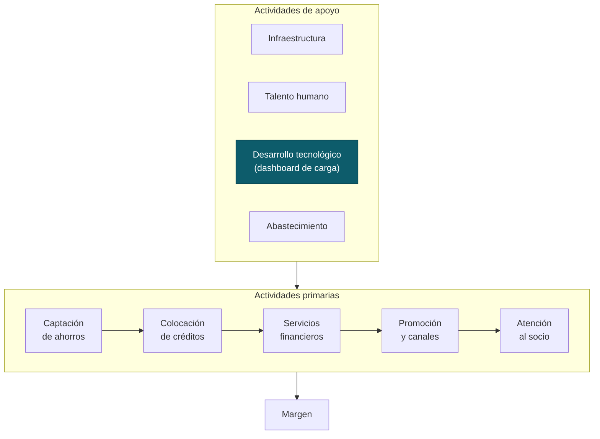

# 3. Cadena de valor

El sistema se ubica en la cadena de valor de Michael Porter adaptada a una cooperativa de ahorro y crédito. Aporta en la actividad de apoyo **Desarrollo tecnológico**.

## Actividades primarias propuestas

1. Captación de ahorros
2. Colocación de créditos
3. Servicios financieros
4. Promoción y canales
5. Atención al socio

## Actividades de apoyo

- Infraestructura
- Talento humano
- **Desarrollo tecnológico** ← aquí aporta el sistema
- Abastecimiento

## Cómo aporta

El área de TI desarrolla y mantiene el software que soporta las actividades primarias (por ejemplo, los módulos del core financiero). Al ver en un solo lugar la carga y el avance de cada desarrollador, la PMO puede repartir mejor el trabajo de Desarrollo tecnológico sin cruzar datos a mano entre RedMine, GitLab, GLPI y Rocket Chat.
