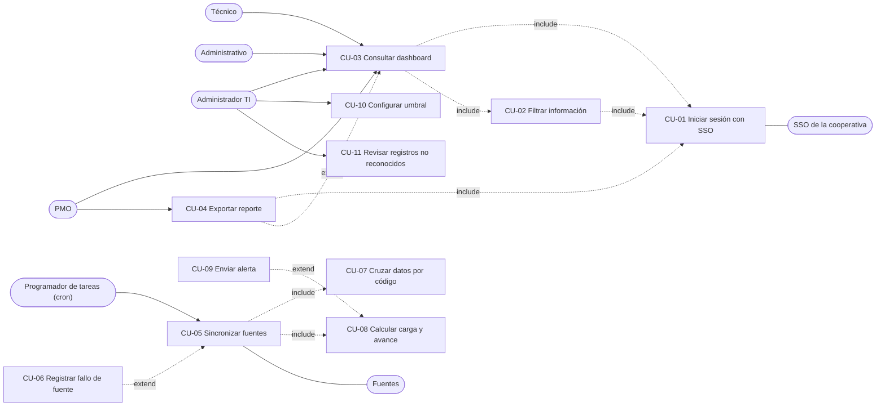

# 4. Casos de uso

## Actores

| Actor | Descripción |
|---|---|
| PMO | Persona de proyectos. Ve la carga de todo el equipo y exporta reportes. |
| Técnico | Desarrollador (rol `TECNICO`). Solo ve su propia carga. |
| Administrativo | Personal administrativo que consulta la carga del equipo. No configura el umbral. |
| Administrador TI | Configura el umbral y revisa los registros no reconocidos. Es el único rol con el permiso `configurar`. |
| Programador de tareas (cron) | Dispara la sincronización cada 15 minutos. |
| SSO de la cooperativa | Autentica a los usuarios. |
| Fuentes | RedMine, GitLab, GLPI y Rocket Chat. |

## Lista de casos de uso

| ID | Caso de uso | Actor | Módulo | Responsable |
|---|---|---|---|---|
| CU-01 | Iniciar sesión con SSO | PMO, Técnico, Administrativo, Administrador TI | Usuario web y seguridad | Camilo |
| CU-02 | Filtrar información | PMO, Técnico, Administrativo, Administrador TI | Usuario web y seguridad | Camilo |
| CU-03 | Consultar dashboard de carga y avance | PMO, Técnico, Administrativo, Administrador TI | Usuario web y seguridad | Camilo |
| CU-04 | Exportar reporte | PMO | Usuario web y seguridad | Camilo |
| CU-05 | Sincronizar fuentes | Programador de tareas (cron) | Integración | Bryan |
| CU-06 | Registrar fallo de fuente | Programador de tareas (cron) | Integración | Bryan |
| CU-07 | Cruzar datos por código | Programador de tareas (cron) | Integración | Bryan |
| CU-08 | Calcular carga y avance | Programador de tareas (cron) | Datos y alertas | Cristina |
| CU-09 | Enviar alerta | Programador de tareas (cron) | Datos y alertas | Cristina |
| CU-10 | Configurar umbral | Administrador TI | Datos y alertas | Cristina |
| CU-11 | Revisar registros no reconocidos | Administrador TI | Datos y alertas | Cristina |

## Relaciones

| Relación | Tipo |
|---|---|
| CU-02 Filtrar información → CU-01 Iniciar sesión con SSO | «include» |
| CU-03 Consultar dashboard → CU-01 Iniciar sesión con SSO | «include» |
| CU-04 Exportar reporte → CU-01 Iniciar sesión con SSO | «include» |
| CU-03 Consultar dashboard → CU-02 Filtrar información | «include» |
| CU-04 Exportar reporte → CU-03 Consultar dashboard | «extend» |
| CU-05 Sincronizar fuentes → CU-07 Cruzar datos por código | «include» |
| CU-05 Sincronizar fuentes → CU-08 Calcular carga y avance | «include» |
| CU-06 Registrar fallo de fuente → CU-05 Sincronizar fuentes | «extend» |
| CU-09 Enviar alerta → CU-08 Calcular carga y avance | «extend» |

## Fichas de casos de uso

Cada responsable completa la ficha de sus casos de uso. Los escenarios en Gherkin están en [`05-especificaciones/`](05-especificaciones/).

### CU-01 Iniciar sesión con SSO

> Responsable: **Camilo**. Módulo: Usuario web y seguridad. Escenarios: [`CU-01-iniciar-sesion-sso.feature`](05-especificaciones/CU-01-iniciar-sesion-sso.feature)

| Campo | Contenido |
|---|---|
| **ID** | CU-01 |
| **Nombre** | Iniciar sesión con SSO |
| **Actores** | PMO, Técnico, Administrativo, Administrador TI; SSO de la cooperativa |
| **Descripción** | Permite que un usuario de la cooperativa ingrese al dashboard con su cuenta del SSO, sin crear otra contraseña. El sistema obtiene su `Rol` y abre una `Sesion` con fecha de expiración. En el prototipo el SSO es simulado: el usuario elige un rol de prueba. |
| **Precondiciones** | El usuario tiene una cuenta en el SSO de la cooperativa con uno de los roles: PMO, Técnico, Administrativo o Administrador TI. |
| **Flujo principal** | 1. El usuario abre la pantalla de inicio de sesión y pulsa **Ingresar con SSO de la cooperativa** (en el prototipo, antes elige un rol de prueba). 2. El frontend envía `POST /api/auth/login` con `{ "rol": "PMO" \| "TECNICO" \| "ADMINISTRATIVO" \| "ADMINISTRADOR_TI" }`. 3. `ServicioSesiones` valida la identidad, obtiene el `Usuario` y su `Rol` (permisos y `soloPropios`) y crea la `Sesion` con `token`, `inicio` y `expira` (`SSO_DURACION_SESION_MIN`, 480 min por defecto). 4. La API responde `201` con la sesión y el frontend muestra el dashboard (CU-03) con el nombre y el rol del usuario en el encabezado. |
| **Flujos alternativos** | **FA-01 (Cerrar sesión):** El usuario pulsa *Cerrar sesión* y el frontend borra la `Sesion` del navegador. La API también ofrece `POST /api/auth/logout` para invalidar el token. **FA-02 (Recuperar sesión):** Si la pestaña ya tiene una `Sesion` guardada (`sessionStorage`) y no ha llegado a `expira`, se entra directo al dashboard. `GET /api/auth/sesion` devuelve los datos de la sesión vigente. |
| **Excepciones** | **EX-01 (Rol inválido):** Si el rol no existe, la API responde `400` y el usuario permanece en el inicio de sesión. **EX-02 (Sesión no válida o expirada):** Cualquier ruta protegida responde `401`; el frontend vuelve al inicio de sesión con el mensaje "Tu sesión expiró. Vuelve a ingresar." **EX-03 (SSO real no configurado):** Con `SSO_MODO` distinto de `mock`, la API responde `501`. |
| **Postcondiciones** | El usuario tiene una `Sesion` válida y todas las demás rutas de la API aceptan su `Authorization: Bearer <token>`. |
| **Requisitos relacionados** | RF-01, RNF-02 |

### CU-02 Filtrar información

> Responsable: **Camilo**. Módulo: Usuario web y seguridad. Escenarios: [`CU-02-filtrar-informacion.feature`](05-especificaciones/CU-02-filtrar-informacion.feature)

| Campo | Contenido |
|---|---|
| **ID** | CU-02 |
| **Nombre** | Filtrar información |
| **Actores** | PMO, Técnico, Administrativo, Administrador TI |
| **Descripción** | Permite acotar la información del dashboard por desarrollador, tipo de trabajo, proyecto, módulo del core y rango de fechas. El `Filtro` se aplica igual a la tabla de peticiones, al gráfico de carga y al resumen. |
| **Precondiciones** | El usuario inició sesión (CU-01). Existe al menos una sincronización con datos (CU-05). |
| **Flujo principal** | 1. El frontend obtiene las opciones con `GET /api/catalogos` (desarrolladores, proyectos, módulos del core, tipos y etapas). 2. El usuario elige uno o varios filtros en el panel: `desarrollador`, `tipo` (`POA`, `REC`, `INICIATIVA`, `INCIDENTE`), `proyecto`, `modulo`, `desde` y `hasta` (`AAAA-MM-DD`). 3. El frontend vuelve a pedir `GET /api/carga` y `GET /api/peticiones` con esos parámetros. 4. La API construye el `Filtro` (`crearFiltro`), le aplica la restricción del `Rol` (`aplicarRestriccionRol`) y devuelve solo los datos que cumplen todos los criterios. |
| **Flujos alternativos** | **FA-01 (Técnico):** Si el rol es Técnico (`soloPropios`), el filtro `desarrollador` queda fijo en su propio desarrollador aunque pida otro. **FA-02 (Limpiar filtros):** El usuario pulsa *Limpiar* y el dashboard vuelve a mostrar todos los datos que su rol puede ver. **FA-03 (Rango de fechas):** Una petición entra en el rango si su periodo planificado (`fechaInicio` a `fechaFin`) se cruza con `desde`–`hasta`. |
| **Excepciones** | **EX-01 (Filtro inválido):** Si el tipo no existe, una fecha no tiene el formato `AAAA-MM-DD` o `desde` es posterior a `hasta`, la API responde `400` con el motivo. |
| **Postcondiciones** | El dashboard muestra solo las peticiones, la carga y el resumen que cumplen el `Filtro`. |
| **Requisitos relacionados** | RF-11, RNF-02 |

### CU-03 Consultar dashboard de carga y avance

> Responsable: **Camilo**. Módulo: Usuario web y seguridad. Escenarios: [`CU-03-consultar-dashboard.feature`](05-especificaciones/CU-03-consultar-dashboard.feature)

| Campo | Contenido |
|---|---|
| **ID** | CU-03 |
| **Nombre** | Consultar dashboard de carga y avance |
| **Actores** | PMO, Técnico, Administrativo, Administrador TI |
| **Descripción** | Muestra en una sola pantalla la carga y el avance de cada desarrollador, con datos de RedMine, GitLab, GLPI y Rocket Chat ya unificados: resumen, gráfico de carga por tipo de trabajo, alertas y tabla de peticiones con su etapa. |
| **Precondiciones** | El usuario inició sesión (CU-01). |
| **Flujo principal** | 1. El frontend pide `GET /api/catalogos` y `GET /api/alertas`. 2. Pide `GET /api/carga` y `GET /api/peticiones` con los filtros vigentes (CU-02). 3. La API calcula el `IndicadorCarga` de cada desarrollador visible (`calcularCarga`) y devuelve el resumen: peticiones abiertas, desarrolladores sobre el umbral, fecha y estado de la última sincronización. 4. El dashboard muestra el resumen, el gráfico de carga por desarrollador y tipo de trabajo, el panel de alertas y la tabla de peticiones con su etapa y avance estimado (Análisis 10 %, Desarrollo 40 %, Certificación 70 %, Despliegue 90 %, Estabilización 100 %). |
| **Flujos alternativos** | **FA-01 (Técnico):** El título es "Tu carga de trabajo" y solo ve su propia carga, peticiones y alertas. **FA-02 (Administrador TI):** Además ve el panel para configurar el umbral (CU-10) y revisar registros no reconocidos (CU-11). **FA-03 (PMO):** Además ve el botón *Exportar* (CU-04). |
| **Excepciones** | **EX-01 (Sesión expirada):** La API responde `401` y el usuario vuelve a CU-01. **EX-02 (Error del servidor):** El dashboard muestra el mensaje de error sin cerrar la sesión. |
| **Postcondiciones** | El usuario ve la carga y el avance actualizados a la última sincronización. |
| **Requisitos relacionados** | RF-07, RF-08, RF-09, RF-10, RF-12, RNF-03 |

### CU-04 Exportar reporte

> Responsable: **Camilo**. Módulo: Usuario web y seguridad. Escenarios: [`CU-04-exportar-reporte.feature`](05-especificaciones/CU-04-exportar-reporte.feature)

| Campo | Contenido |
|---|---|
| **ID** | CU-04 |
| **Nombre** | Exportar reporte |
| **Actores** | PMO |
| **Descripción** | Permite a la PMO descargar en Excel o PDF lo que ve en el dashboard, con los filtros aplicados y la fecha de la última sincronización. **Estado: pendiente (Sprint 4).** Hoy el botón *Exportar* solo muestra el aviso "La exportación a Excel y PDF llega en el Sprint 4." |
| **Precondiciones** | El usuario inició sesión (CU-01) con el rol PMO (permiso `exportar`) y está en el dashboard (CU-03). |
| **Flujo principal** | 1. La PMO pulsa **Exportar** y elige Excel o PDF. 2. El frontend pide `GET /api/reportes?formato=xlsx\|pdf` con los filtros vigentes (CU-02). 3. La API genera el `Reporte` con las peticiones filtradas y la fecha de la última sincronización (`fechaUltimaSync`). 4. El navegador descarga el archivo. |
| **Flujos alternativos** | Ninguno. |
| **Excepciones** | **EX-01 (Sin permiso):** Los roles Técnico, Administrativo y Administrador TI no ven el botón *Exportar*; si llaman a la ruta, la API responde `403`. |
| **Postcondiciones** | La PMO tiene un archivo Excel o PDF con los mismos datos que veía en el dashboard. |
| **Requisitos relacionados** | RF-13 |

### CU-05 Sincronizar fuentes

> Responsable: **Bryan**. Módulo: Integración. Escenarios: [`CU-05-sincronizar-fuentes.feature`](05-especificaciones/CU-05-sincronizar-fuentes.feature)

| Campo | Contenido |
|---|---|
| **ID** | CU-05 |
| **Nombre** | Sincronizar fuentes |
| **Actores** | Programador de tareas (cron); Fuentes |
| **Descripción** | Cada 15 minutos el Programador de tareas (cron) lee las cuatro fuentes por su API, unifica los datos por código y actualiza la carga, el avance y las alertas. Cada fuente se lee con su `Conector` (`ConectorRedmine`, `ConectorGitlab`, `ConectorGlpi`, `ConectorRocketChat`). |
| **Precondiciones** | El backend está en ejecución y `SYNC_CRON` es una expresión válida (`*/15 * * * *` por defecto). Con `USAR_MOCKS=true` las fuentes se leen de `backend/mocks/`. |
| **Flujo principal** | 1. El Programador de tareas dispara `Sincronizacion.ejecutar()` (también se ejecuta una vez al arrancar el backend). 2. La `Sincronizacion` lee en paralelo las cuatro `Fuente` con `leerConReintentos()`, hasta 3 intentos cada una (`SYNC_REINTENTOS`). 3. Guarda los datos de cada fuente que respondió como sus últimos datos buenos (`lectura_fuente`). 4. Cruza los datos por código (CU-07). 5. Calcula la carga y el avance (CU-08) y genera las alertas (CU-09). 6. Guarda el resultado y el estado (`ok`, `parcial` o `fallida`), consultable en `GET /api/sincronizacion/estado`. |
| **Flujos alternativos** | **FA-01 (Ya hay una en curso):** Si una sincronización sigue ejecutándose, la nueva no se inicia. **FA-02 (Fuente caída):** Si una fuente falla tras los reintentos, se extiende con CU-06 y la sincronización termina como `parcial`. |
| **Excepciones** | **EX-01 (Todas las fuentes fallan):** El estado es `fallida`; el dashboard sigue mostrando los últimos datos guardados. **EX-02 (Error inesperado):** El programador registra el error en el log y lo intenta de nuevo en el siguiente ciclo. |
| **Postcondiciones** | Las peticiones, indicadores, alertas y registros no reconocidos quedan actualizados en el almacén (memoria o PostgreSQL). |
| **Requisitos relacionados** | RF-02, RF-03, RF-04, RF-05, RNF-01, RNF-04 |

### CU-06 Registrar fallo de fuente

> Responsable: **Bryan**. Módulo: Integración. Escenarios: [`CU-06-registrar-fallo-fuente.feature`](05-especificaciones/CU-06-registrar-fallo-fuente.feature)

| Campo | Contenido |
|---|---|
| **ID** | CU-06 |
| **Nombre** | Registrar fallo de fuente |
| **Actores** | Programador de tareas (cron) |
| **Descripción** | Cuando una fuente no responde tras 3 intentos, la sincronización no se detiene: registra el fallo (`RegistroFallo`) y usa los últimos datos buenos de esa fuente. |
| **Precondiciones** | Se está ejecutando una sincronización (CU-05). |
| **Flujo principal** | 1. Una `Fuente` falla 3 veces seguidas (con `SYNC_ESPERA_REINTENTO_MS` entre intentos). 2. La `Sincronizacion` crea un `RegistroFallo` con la fuente, la fecha, los intentos y el mensaje de error. 3. Recupera los últimos datos buenos de esa fuente (`ultimosDatosFuente()`; en PostgreSQL, tabla `lectura_fuente`). 4. Marca la fuente como `con-datos-anteriores` y continúa con CU-07. |
| **Flujos alternativos** | **FA-01 (Nunca respondió):** Si la fuente no tiene datos anteriores, se marca como `sin-datos` y se continúa con las demás. |
| **Excepciones** | Ninguna: el fallo de una fuente no interrumpe la sincronización. |
| **Postcondiciones** | El fallo queda registrado (`GET /api/sincronizacion/estado` → `fallos`) y la sincronización termina como `parcial` (o `fallida` si fallaron todas). |
| **Requisitos relacionados** | RNF-01 |

### CU-07 Cruzar datos por código

> Responsable: **Bryan**. Módulo: Integración. Escenarios: [`CU-07-cruzar-datos-por-codigo.feature`](05-especificaciones/CU-07-cruzar-datos-por-codigo.feature)

| Campo | Contenido |
|---|---|
| **ID** | CU-07 |
| **Nombre** | Cruzar datos por código |
| **Actores** | Programador de tareas (cron) |
| **Descripción** | Une los datos de las cuatro fuentes usando el código de la petición de RedMine, sin duplicar. Lo que no se puede cruzar se guarda como `RegistroNoReconocido` para que lo revise el Administrador TI (CU-11). |
| **Precondiciones** | La sincronización obtuvo los datos de las fuentes (CU-05, y CU-06 si alguna falló). |
| **Flujo principal** | 1. El `normalizador` toma las peticiones de RedMine como fuente principal y reconoce su código: `POA-AAAA-NNN`, `REC-AAAA-NNN`, `INC-AAAA-NNN` o `iniciativa.ti.NNN`. 2. Clasifica cada `Peticion` por `TipoTrabajo` y `Etapa`, y la asigna al `Desarrollador` según su usuario de RedMine. 3. Une los incidentes de GLPI con la petición del mismo código, sin crear duplicados. 4. Asocia los commits, merge requests y pipelines de GitLab a la petición cuyo código aparece en la rama (`ActividadCodigo`). 5. Asocia las notificaciones de Rocket Chat que mencionan un código. 6. Calcula los módulos del core con cambios (`ModuloCore`). |
| **Flujos alternativos** | **FA-01 (Petición repetida en RedMine):** Se conserva la primera y se descartan las demás. |
| **Excepciones** | **EX-01 (Dato sin código válido):** Una petición de RedMine sin código, tipo o etapa válidos, un incidente de GLPI o una rama de GitLab que no corresponde a ninguna petición se guardan como `RegistroNoReconocido` con su fuente, código original y motivo. |
| **Postcondiciones** | Cada `Peticion` tiene un solo registro con sus actividades, módulos y desarrollador; los datos no cruzados quedan pendientes de revisión (CU-11). |
| **Requisitos relacionados** | RF-06, RF-07, RF-09 |

### CU-08 Calcular carga y avance

> Responsable: **Cristina**. Módulo: Datos y alertas. Escenarios: [`CU-08-calcular-carga-avance.feature`](05-especificaciones/CU-08-calcular-carga-avance.feature)

| Campo | Contenido |
|---|---|
| **ID** | CU-08 |
| **Nombre** | Calcular carga y avance |
| **Actores** | Programador de tareas (cron) |
| **Descripción** | Calcula la cantidad de peticiones abiertas asignadas a cada desarrollador, las clasifica por tipo de trabajo, estima su avance promedio según la etapa de RedMine y evalúa si supera el umbral configurado. |
| **Precondiciones** | Existen desarrolladores activos y peticiones normalizadas tras ejecutar la sincronización (CU-05 y CU-07). |
| **Flujo principal** | 1. El sistema filtra las peticiones en estado `abierta` asignadas a cada desarrollador. 2. Clasifica las peticiones abiertas por `TipoTrabajo` (`POA`, `REC`, `INICIATIVA`, `INCIDENTE`). 3. Estima el porcentaje de avance de cada petición según su `Etapa` (10 %, 40 %, 70 %, 90 %, 100 %) y obtiene el promedio. 4. Compara el total de peticiones abiertas contra `Umbral.maxPeticiones` y genera el `IndicadorCarga`. |
| **Flujos alternativos** | **FA-01 (Sin peticiones abiertas):** Si el desarrollador no tiene peticiones abiertas, su carga es `0`, su avance promedio es `0 %` y `superaUmbral` es `false`. |
| **Excepciones** | **EX-01 (Etapa no reconocida):** Si una petición tiene una etapa fuera del catálogo, su avance estimado se toma como `0 %` sin interrumpir el cálculo del resto. |
| **Postcondiciones** | Se almacenan los indicadores actualizados (`IndicadorCarga`) disponibles para consulta en el dashboard y evaluación de alertas (CU-09). |
| **Requisitos relacionados** | RF-08, RF-10 |

### CU-09 Enviar alerta

> Responsable: **Cristina**. Módulo: Datos y alertas. Escenarios: [`CU-09-enviar-alerta.feature`](05-especificaciones/CU-09-enviar-alerta.feature)

| Campo | Contenido |
|---|---|
| **ID** | CU-09 |
| **Nombre** | Enviar alerta |
| **Actores** | Programador de tareas (cron) |
| **Descripción** | Genera una alerta visible en el dashboard y envía una notificación al canal de Rocket Chat configurado cuando la carga de un desarrollador supera el umbral permitido. |
| **Precondiciones** | Se ha ejecutado el cálculo de carga (CU-08) y existe al menos un desarrollador con `peticionesAbiertas > umbral.maxPeticiones`. |
| **Flujo principal** | 1. El sistema identifica los indicadores donde `superaUmbral` es verdadero. 2. Crea un objeto `Alerta` con el detalle del desarrollador, sus peticiones abiertas y el umbral vigente. 3. Verifica si ya se envió previamente esa misma alerta para evitar notificaciones duplicadas. 4. Envía el mensaje mediante `POST /api/v1/chat.postMessage` a Rocket Chat y registra la alerta en el almacén. |
| **Flujos alternativos** | **FA-01 (Modo pruebas o sin Rocket Chat):** Si `usarMocks` está activo o no hay URL configurada, la alerta se registra en pantalla con `enviadaRocketChat = false`. **FA-02 (Alerta ya notificada):** Si la carga sobre el umbral no cambió desde el último envío para ese desarrollador, se mantiene la alerta en pantalla sin reenviar mensaje a Rocket Chat. |
| **Excepciones** | **EX-01 (Fallo de conexión con Rocket Chat):** Si la API de Rocket Chat responde con error o timeout, se registra el error en bitácora y la alerta queda visible en el dashboard sin abortar la sincronización. |
| **Postcondiciones** | Las alertas vigentes quedan disponibles en `GET /api/alertas` y notificadas en Rocket Chat. |
| **Requisitos relacionados** | RF-12 |

### CU-10 Configurar umbral

> Responsable: **Cristina**. Módulo: Datos y alertas. Escenarios: [`CU-10-configurar-umbral.feature`](05-especificaciones/CU-10-configurar-umbral.feature)

| Campo | Contenido |
|---|---|
| **ID** | CU-10 |
| **Nombre** | Configurar umbral |
| **Actores** | Administrador TI |
| **Descripción** | Permite al Administrador TI modificar el límite máximo de peticiones abiertas por desarrollador antes de disparar alertas de sobrecarga. |
| **Precondiciones** | El usuario ha iniciado sesión (CU-01) y tiene el rol Administrador TI (permiso `configurar`). |
| **Flujo principal** | 1. El Administrador TI envía el nuevo valor entero positivo para `maxPeticiones`. 2. El sistema valida que el valor sea un entero mayor o igual a `1`. 3. Actualiza el umbral vigente registrando quién realizó el cambio y la fecha. 4. Recalcula el indicador `superaUmbral` y las alertas vigentes con el nuevo límite. |
| **Flujos alternativos** | Ninguno. |
| **Excepciones** | **EX-01 (Valor inválido):** Si `maxPeticiones` no es un entero positivo (`<= 0` o no numérico), el sistema devuelve HTTP `400` y conserva el umbral previo. **EX-02 (Sin permisos):** Si un usuario sin el rol Administrador TI (por ejemplo, Administrativo) intenta modificar el umbral, el sistema devuelve HTTP `403`. |
| **Postcondiciones** | El nuevo umbral queda activo para las consultas inmediatas y futuras sincronizaciones. |
| **Requisitos relacionados** | RF-12, RNF-02 |

### CU-11 Revisar registros no reconocidos

> Responsable: **Cristina**. Módulo: Datos y alertas. Escenarios: [`CU-11-revisar-registros-no-reconocidos.feature`](05-especificaciones/CU-11-revisar-registros-no-reconocidos.feature)

| Campo | Contenido |
|---|---|
| **ID** | CU-11 |
| **Nombre** | Revisar registros no reconocidos |
| **Actores** | Administrador TI |
| **Descripción** | Permite consultar los registros provenientes de GitLab, GLPI o Rocket Chat cuyo código no coincidió con ninguna petición de RedMine durante el cruce (CU-07), para asociarlos manualmente o marcarlos como revisados. |
| **Precondiciones** | El usuario ha iniciado sesión (CU-01) con el rol Administrador TI y existen registros detectados en `RegistroNoReconocido`. |
| **Flujo principal** | 1. El Administrador TI consulta el listado de registros no reconocidos pendientes. 2. El sistema muestra la fuente de origen, código original, motivo y fecha de detección. 3. El administrador selecciona un registro y lo marca como revisado (o lo vincula a un código de petición válido). 4. El sistema actualiza el estado del registro a `revisado = true`. |
| **Flujos alternativos** | **FA-01 (Filtrar por estado):** El administrador puede consultar tanto los registros pendientes como los ya revisados. |
| **Excepciones** | **EX-01 (Registro inexistente):** Si el identificador enviado no existe, el sistema responde HTTP `404`. **EX-02 (Sin permisos):** Si el usuario no tiene el rol Administrador TI, el sistema responde HTTP `403`. |
| **Postcondiciones** | El registro queda marcado como revisado y disminuye el contador de registros pendientes en el resumen de sincronización. |
| **Requisitos relacionados** | RF-06 |
