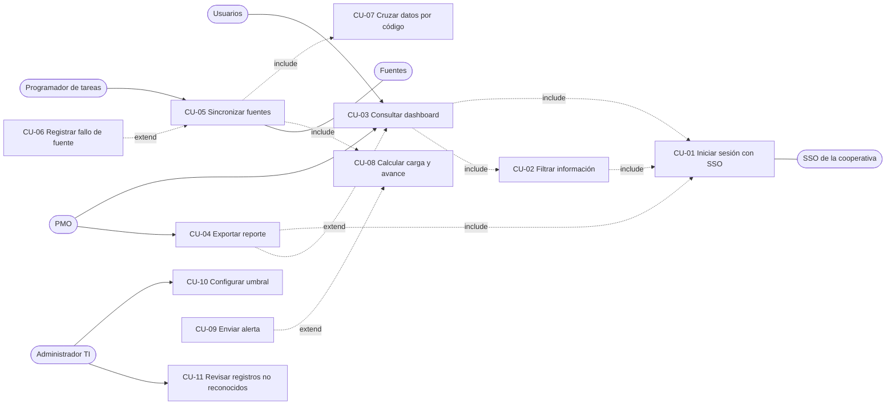

# 4. Casos de uso

## Actores

| Actor | Descripción |
|---|---|
| PMO | Persona de proyectos. Ve la carga de todo el equipo y exporta reportes. |
| Usuario técnico | Desarrollador. Solo ve su propia carga. |
| Usuario administrativo | Personal administrativo que consulta la carga del equipo. No configura el umbral. |
| Administrador TI | Configura el umbral y revisa los registros no reconocidos. Es el único rol con el permiso `configurar`. |
| Programador de tareas (cron) | Dispara la sincronización cada 15 minutos. |
| SSO de la cooperativa | Autentica a los usuarios. |
| Fuentes | RedMine, GitLab, GLPI y Rocket Chat. |

## Lista de casos de uso

| ID | Caso de uso | Actor | Módulo | Responsable |
|---|---|---|---|---|
| CU-01 | Iniciar sesión con SSO | PMO, usuarios | Usuario web y seguridad | Camilo |
| CU-02 | Filtrar información | PMO, usuarios | Usuario web y seguridad | Camilo |
| CU-03 | Consultar dashboard de carga y avance | PMO, usuarios | Usuario web y seguridad | Camilo |
| CU-04 | Exportar reporte | PMO | Usuario web y seguridad | Camilo |
| CU-05 | Sincronizar fuentes | Programador de tareas (cron) | Integración | Bryan |
| CU-06 | Registrar fallo de fuente | Programador de tareas | Integración | Bryan |
| CU-07 | Cruzar datos por código | Programador de tareas | Integración | Bryan |
| CU-08 | Calcular carga y avance | Programador de tareas | Datos y alertas | Cristina |
| CU-09 | Enviar alerta | Programador de tareas | Datos y alertas | Cristina |
| CU-10 | Configurar umbral | Administrador TI | Datos y alertas | Cristina |
| CU-11 | Revisar registros no reconocidos | Administrador TI | Datos y alertas | Cristina |

## Relaciones

| Relación | Tipo |
|---|---|
| CU-02 Filtrar información → CU-01 Iniciar sesión con SSO | «include» |
| CU-03 Consultar dashboard → CU-01 Iniciar sesión con SSO | «include» |
| CU-04 Exportar reporte → CU-01 Iniciar sesión con SSO | «include» |
| CU-03 Consultar dashboard → CU-02 Filtrar información | «include» |
| CU-04 Exportar reporte → CU-03 Consultar dashboard | «extend» |
| CU-05 Sincronizar fuentes → CU-07 Cruzar datos por código | «include» |
| CU-05 Sincronizar fuentes → CU-08 Calcular carga y avance | «include» |
| CU-06 Registrar fallo de fuente → CU-05 Sincronizar fuentes | «extend» |
| CU-09 Enviar alerta → CU-08 Calcular carga y avance | «extend» |

## Fichas de casos de uso

Cada responsable completa la ficha de sus casos de uso. Los escenarios en Gherkin están en [`05-especificaciones/`](05-especificaciones/).

### CU-01 Iniciar sesión con SSO

> Responsable: **Camilo**. Módulo: Usuario web y seguridad. Escenarios: [`CU-01-iniciar-sesion-sso.feature`](05-especificaciones/CU-01-iniciar-sesion-sso.feature)

| Campo | Contenido |
|---|---|
| **ID** | CU-01 |
| **Nombre** | Iniciar sesión con SSO |
| **Actores** | PMO, usuarios; SSO de la cooperativa |
| **Descripción** | |
| **Precondiciones** | |
| **Flujo principal** | 1.  2.  3. |
| **Flujos alternativos** | |
| **Excepciones** | |
| **Postcondiciones** | |
| **Requisitos relacionados** | |

### CU-02 Filtrar información

> Responsable: **Camilo**. Módulo: Usuario web y seguridad. Escenarios: [`CU-02-filtrar-informacion.feature`](05-especificaciones/CU-02-filtrar-informacion.feature)

| Campo | Contenido |
|---|---|
| **ID** | CU-02 |
| **Nombre** | Filtrar información |
| **Actores** | PMO, usuarios |
| **Descripción** | |
| **Precondiciones** | |
| **Flujo principal** | 1.  2.  3. |
| **Flujos alternativos** | |
| **Excepciones** | |
| **Postcondiciones** | |
| **Requisitos relacionados** | |

### CU-03 Consultar dashboard de carga y avance

> Responsable: **Camilo**. Módulo: Usuario web y seguridad. Escenarios: [`CU-03-consultar-dashboard.feature`](05-especificaciones/CU-03-consultar-dashboard.feature)

| Campo | Contenido |
|---|---|
| **ID** | CU-03 |
| **Nombre** | Consultar dashboard de carga y avance |
| **Actores** | PMO, usuarios |
| **Descripción** | |
| **Precondiciones** | |
| **Flujo principal** | 1.  2.  3. |
| **Flujos alternativos** | |
| **Excepciones** | |
| **Postcondiciones** | |
| **Requisitos relacionados** | |

### CU-04 Exportar reporte

> Responsable: **Camilo**. Módulo: Usuario web y seguridad. Escenarios: [`CU-04-exportar-reporte.feature`](05-especificaciones/CU-04-exportar-reporte.feature)

| Campo | Contenido |
|---|---|
| **ID** | CU-04 |
| **Nombre** | Exportar reporte |
| **Actores** | PMO |
| **Descripción** | |
| **Precondiciones** | |
| **Flujo principal** | 1.  2.  3. |
| **Flujos alternativos** | |
| **Excepciones** | |
| **Postcondiciones** | |
| **Requisitos relacionados** | |

### CU-05 Sincronizar fuentes

> Responsable: **Bryan**. Módulo: Integración. Escenarios: [`CU-05-sincronizar-fuentes.feature`](05-especificaciones/CU-05-sincronizar-fuentes.feature)

| Campo | Contenido |
|---|---|
| **ID** | CU-05 |
| **Nombre** | Sincronizar fuentes |
| **Actores** | Programador de tareas (cron); Fuentes |
| **Descripción** | |
| **Precondiciones** | |
| **Flujo principal** | 1.  2.  3. |
| **Flujos alternativos** | |
| **Excepciones** | |
| **Postcondiciones** | |
| **Requisitos relacionados** | |

### CU-06 Registrar fallo de fuente

> Responsable: **Bryan**. Módulo: Integración. Escenarios: [`CU-06-registrar-fallo-fuente.feature`](05-especificaciones/CU-06-registrar-fallo-fuente.feature)

| Campo | Contenido |
|---|---|
| **ID** | CU-06 |
| **Nombre** | Registrar fallo de fuente |
| **Actores** | Programador de tareas |
| **Descripción** | |
| **Precondiciones** | |
| **Flujo principal** | 1.  2.  3. |
| **Flujos alternativos** | |
| **Excepciones** | |
| **Postcondiciones** | |
| **Requisitos relacionados** | |

### CU-07 Cruzar datos por código

> Responsable: **Bryan**. Módulo: Integración. Escenarios: [`CU-07-cruzar-datos-por-codigo.feature`](05-especificaciones/CU-07-cruzar-datos-por-codigo.feature)

| Campo | Contenido |
|---|---|
| **ID** | CU-07 |
| **Nombre** | Cruzar datos por código |
| **Actores** | Programador de tareas |
| **Descripción** | |
| **Precondiciones** | |
| **Flujo principal** | 1.  2.  3. |
| **Flujos alternativos** | |
| **Excepciones** | |
| **Postcondiciones** | |
| **Requisitos relacionados** | |

### CU-08 Calcular carga y avance

> Responsable: **Cristina**. Módulo: Datos y alertas. Escenarios: [`CU-08-calcular-carga-avance.feature`](05-especificaciones/CU-08-calcular-carga-avance.feature)

| Campo | Contenido |
|---|---|
| **ID** | CU-08 |
| **Nombre** | Calcular carga y avance |
| **Actores** | Programador de tareas (cron) |
| **Descripción** | Calcula la cantidad de peticiones abiertas asignadas a cada desarrollador, las clasifica por tipo de trabajo, estima su avance promedio según la etapa de RedMine y evalúa si supera el umbral configurado. |
| **Precondiciones** | Existen desarrolladores activos y peticiones normalizadas tras ejecutar la sincronización (CU-05 y CU-07). |
| **Flujo principal** | 1. El sistema filtra las peticiones en estado `abierta` asignadas a cada desarrollador. 2. Clasifica las peticiones abiertas por `TipoTrabajo` (`POA`, `REC`, `INICIATIVA`, `INCIDENTE`). 3. Estima el porcentaje de avance de cada petición según su `Etapa` (10 %, 40 %, 70 %, 90 %, 100 %) y obtiene el promedio. 4. Compara el total de peticiones abiertas contra `Umbral.maxPeticiones` y genera el `IndicadorCarga`. |
| **Flujos alternativos** | **FA-01 (Sin peticiones abiertas):** Si el desarrollador no tiene peticiones abiertas, su carga es `0`, su avance promedio es `0 %` y `superaUmbral` es `false`. |
| **Excepciones** | **EX-01 (Etapa no reconocida):** Si una petición tiene una etapa fuera del catálogo, su avance estimado se toma como `0 %` sin interrumpir el cálculo del resto. |
| **Postcondiciones** | Se almacenan los indicadores actualizados (`IndicadorCarga`) disponibles para consulta en el dashboard y evaluación de alertas (CU-09). |
| **Requisitos relacionados** | RF-08, RF-10 |

### CU-09 Enviar alerta

> Responsable: **Cristina**. Módulo: Datos y alertas. Escenarios: [`CU-09-enviar-alerta.feature`](05-especificaciones/CU-09-enviar-alerta.feature)

| Campo | Contenido |
|---|---|
| **ID** | CU-09 |
| **Nombre** | Enviar alerta |
| **Actores** | Programador de tareas (cron) |
| **Descripción** | Genera una alerta visible en el dashboard y envía una notificación al canal de Rocket Chat configurado cuando la carga de un desarrollador supera el umbral permitido. |
| **Precondiciones** | Se ha ejecutado el cálculo de carga (CU-08) y existe al menos un desarrollador con `peticionesAbiertas > umbral.maxPeticiones`. |
| **Flujo principal** | 1. El sistema identifica los indicadores donde `superaUmbral` es verdadero. 2. Crea un objeto `Alerta` con el detalle del desarrollador, sus peticiones abiertas y el umbral vigente. 3. Verifica si ya se envió previamente esa misma alerta para evitar notificaciones duplicadas. 4. Envía el mensaje mediante `POST /api/v1/chat.postMessage` a Rocket Chat y registra la alerta en el almacén. |
| **Flujos alternativos** | **FA-01 (Modo pruebas o sin Rocket Chat):** Si `usarMocks` está activo o no hay URL configurada, la alerta se registra en pantalla con `enviadaRocketChat = false`. **FA-02 (Alerta ya notificada):** Si la carga sobre el umbral no cambió desde el último envío para ese desarrollador, se mantiene la alerta en pantalla sin reenviar mensaje a Rocket Chat. |
| **Excepciones** | **EX-01 (Fallo de conexión con Rocket Chat):** Si la API de Rocket Chat responde con error o timeout, se registra el error en bitácora y la alerta queda visible en el dashboard sin abortar la sincronización. |
| **Postcondiciones** | Las alertas vigentes quedan disponibles en `GET /api/alertas` y notificadas en Rocket Chat. |
| **Requisitos relacionados** | RF-12 |

### CU-10 Configurar umbral

> Responsable: **Cristina**. Módulo: Datos y alertas. Escenarios: [`CU-10-configurar-umbral.feature`](05-especificaciones/CU-10-configurar-umbral.feature)

| Campo | Contenido |
|---|---|
| **ID** | CU-10 |
| **Nombre** | Configurar umbral |
| **Actores** | Administrador TI |
| **Descripción** | Permite al Administrador TI modificar el límite máximo de peticiones abiertas por desarrollador antes de disparar alertas de sobrecarga. |
| **Precondiciones** | El usuario ha iniciado sesión (CU-01) y tiene el rol Administrador TI (permiso `configurar`). |
| **Flujo principal** | 1. El Administrador TI envía el nuevo valor entero positivo para `maxPeticiones`. 2. El sistema valida que el valor sea un entero mayor o igual a `1`. 3. Actualiza el umbral vigente registrando quién realizó el cambio y la fecha. 4. Recalcula el indicador `superaUmbral` y las alertas vigentes con el nuevo límite. |
| **Flujos alternativos** | Ninguno. |
| **Excepciones** | **EX-01 (Valor inválido):** Si `maxPeticiones` no es un entero positivo (`<= 0` o no numérico), el sistema devuelve HTTP `400` y conserva el umbral previo. **EX-02 (Sin permisos):** Si un usuario sin el rol Administrador TI (por ejemplo, Administrativo) intenta modificar el umbral, el sistema devuelve HTTP `403`. |
| **Postcondiciones** | El nuevo umbral queda activo para las consultas inmediatas y futuras sincronizaciones. |
| **Requisitos relacionados** | RF-12, RNF-02 |

### CU-11 Revisar registros no reconocidos

> Responsable: **Cristina**. Módulo: Datos y alertas. Escenarios: [`CU-11-revisar-registros-no-reconocidos.feature`](05-especificaciones/CU-11-revisar-registros-no-reconocidos.feature)

| Campo | Contenido |
|---|---|
| **ID** | CU-11 |
| **Nombre** | Revisar registros no reconocidos |
| **Actores** | Administrador TI |
| **Descripción** | Permite consultar los registros provenientes de GitLab, GLPI o Rocket Chat cuyo código no coincidió con ninguna petición de RedMine durante el cruce (CU-07), para asociarlos manualmente o marcarlos como revisados. |
| **Precondiciones** | El usuario ha iniciado sesión (CU-01) con el rol Administrador TI y existen registros detectados en `RegistroNoReconocido`. |
| **Flujo principal** | 1. El Administrador TI consulta el listado de registros no reconocidos pendientes. 2. El sistema muestra la fuente de origen, código original, motivo y fecha de detección. 3. El administrador selecciona un registro y lo marca como revisado (o lo vincula a un código de petición válido). 4. El sistema actualiza el estado del registro a `revisado = true`. |
| **Flujos alternativos** | **FA-01 (Filtrar por estado):** El administrador puede consultar tanto los registros pendientes como los ya revisados. |
| **Excepciones** | **EX-01 (Registro inexistente):** Si el identificador enviado no existe, el sistema responde HTTP `404`. **EX-02 (Sin permisos):** Si el usuario no tiene el rol Administrador TI, el sistema responde HTTP `403`. |
| **Postcondiciones** | El registro queda marcado como revisado y disminuye el contador de registros pendientes en el resumen de sincronización. |
| **Requisitos relacionados** | RF-06 |
