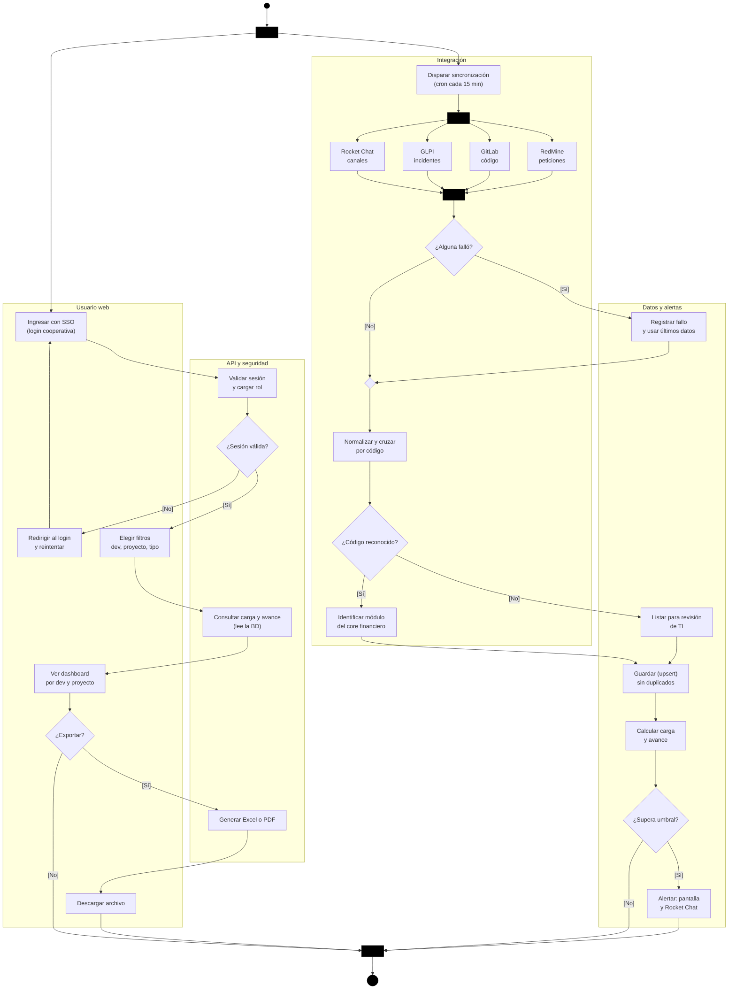
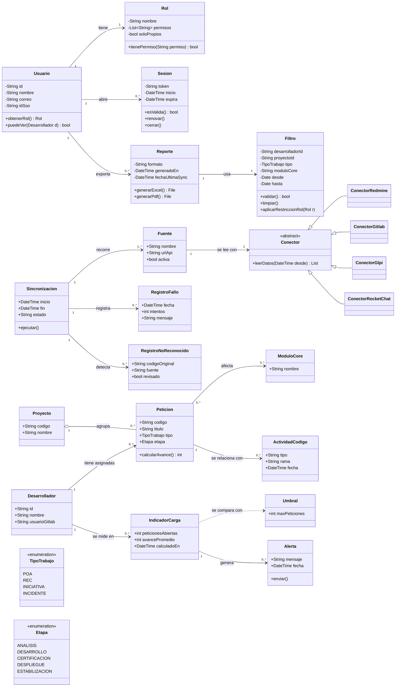

# 6. Diagramas

## Diagrama de actividades

Muestra en paralelo la sincronización automática (Integración y Datos y alertas) y el uso del dashboard (Usuario web y API y seguridad).

## Diagrama de clases (base)

Diagrama base. Cristina se encarga de unir el diagrama de clases final con los aportes de cada módulo.

| Módulo | Clases | Responsable |
|---|---|---|
| Usuario web y seguridad | Usuario, Rol, Sesion, Filtro, Reporte | Camilo |
| Integración | Fuente, Conector y sus hijas, Sincronizacion, RegistroFallo | Bryan |
| Datos y alertas | Desarrollador, Peticion, Proyecto, ModuloCore, ActividadCodigo, IndicadorCarga, Umbral, Alerta, RegistroNoReconocido | Cristina |

> En el prototipo, las clases de dominio se implementan como objetos y funciones de JavaScript (por ejemplo, `calcularAvance()` en `backend/src/datos/avance.js`). La correspondencia con las tablas está en `database/schema.sql`.
