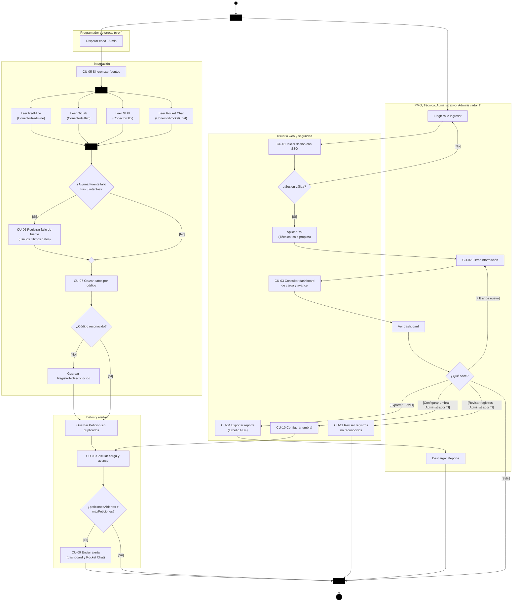
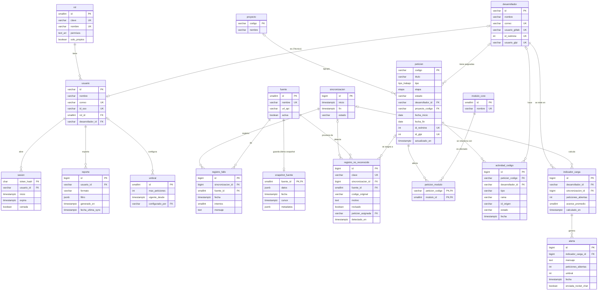

# 6. Diagramas

> **Entrega oficial de diagramas:** [diagramas/README.md](diagramas/README.md) (los 9 en el orden de la rúbrica, con imágenes). Este documento conserva el diccionario de nombres (6.0), el diagrama de actividades (6.2) y el entidad-relación (6.5).

Todos los diagramas usan **los mismos nombres**. La fuente de verdad es el código; si algo cambia en el código, se actualiza primero la tabla de la sección 6.0 y después los diagramas.

| # | Diagrama | Qué muestra |
|---|---|---|
| 6.0 | Diccionario de nombres | Cómo se llama cada cosa en cada diagrama, en el código y en la base de datos |
| 6.1 | Casos de uso | [diagramas/04-casos-de-uso.puml](diagramas/04-casos-de-uso.puml) y [04-casos-de-uso.md](04-casos-de-uso.md#relaciones) |
| 6.2 | Actividades | Sincronización automática y uso del dashboard, por módulo |
| 6.3 | Clases | [diagramas/05-clases.mmd](diagramas/05-clases.mmd) |
| 6.4 | Secuencia | Uno por caso de uso en [diagramas/06-secuencia/](diagramas/06-secuencia/) |
| 6.5 | Entidad-relación | Tablas de `database/schema.sql` |
| 6.6 | Componentes, paquetes y despliegue | [diagramas/](diagramas/README.md) |

## 6.0 Diccionario de nombres

### Actores y roles

| Actor (casos de uso, actividades, secuencia) | Clave del rol en el código (`auth/roles.js`) | Tabla `rol.clave` | Permisos |
|---|---|---|---|
| PMO | `PMO` | `PMO` | `ver:todos`, `exportar` |
| Técnico | `TECNICO` | `TECNICO` | `ver:propios` (solo su carga) |
| Administrativo | `ADMINISTRATIVO` | `ADMINISTRATIVO` | `ver:todos` |
| Administrador TI | `ADMINISTRADOR_TI` | `ADMINISTRADOR_TI` | `ver:todos`, `configurar` |
| Programador de tareas (cron) | `sincronizacion/programador.js` | — | — |
| SSO de la cooperativa | `auth/sso-mock.js` (`ServicioSesiones`) | — | — |
| Fuentes (RedMine, GitLab, GLPI, Rocket Chat) | `Fuente` + `Conector*` | `fuente` | — |

### Módulos (carriles del diagrama de actividades)

| Módulo | Responsable | Carpeta |
|---|---|---|
| Usuario web y seguridad | Camilo | `frontend/`, `backend/src/auth/`, `backend/src/rutas/` |
| Integración | Bryan | `backend/src/conectores/`, `backend/src/sincronizacion/` |
| Datos y alertas | Cristina | `backend/src/datos/`, `database/` |

### Casos de uso → acciones del diagrama de actividades

En el diagrama de actividades cada acción lleva el **mismo nombre e ID** que su caso de uso.

| ID | Caso de uso / acción | Actor | Ruta de la API |
|---|---|---|---|
| CU-01 | Iniciar sesión con SSO | PMO, Técnico, Administrativo, Administrador TI | `POST /api/auth/login` |
| CU-02 | Filtrar información | PMO, Técnico, Administrativo, Administrador TI | `GET /api/catalogos` + parámetros de filtro |
| CU-03 | Consultar dashboard de carga y avance | PMO, Técnico, Administrativo, Administrador TI | `GET /api/carga`, `GET /api/peticiones`, `GET /api/alertas` |
| CU-04 | Exportar reporte | PMO | `GET /api/reportes` (pendiente, Sprint 4) |
| CU-05 | Sincronizar fuentes | Programador de tareas (cron) | `GET /api/sincronizacion/estado` |
| CU-06 | Registrar fallo de fuente | Programador de tareas (cron) | — |
| CU-07 | Cruzar datos por código | Programador de tareas (cron) | — |
| CU-08 | Calcular carga y avance | Programador de tareas (cron) | — |
| CU-09 | Enviar alerta | Programador de tareas (cron) | — |
| CU-10 | Configurar umbral | Administrador TI | `PUT /api/umbral` |
| CU-11 | Revisar registros no reconocidos | Administrador TI | `GET` y `PATCH /api/registros-no-reconocidos` |

### Clases → tablas

| Clase (diagrama de clases y código) | Tabla (`schema.sql`) | Atributos (clase → columna) |
|---|---|---|
| `Usuario` | `usuario` | `id`, `nombre`, `correo`, `idSso` → `id_sso`, `desarrolladorId` → `desarrollador_id` |
| `Rol` | `rol` | `clave`, `nombre`, `permisos`, `soloPropios` → `solo_propios` |
| `Sesion` | `sesion` | `token` → `token_hash` (solo se guarda el hash), `inicio`, `expira` |
| `Filtro` | — (se guarda como JSON en `reporte.filtro`) | `desarrolladorId`, `proyectoId`, `tipo`, `moduloCore`, `desde`, `hasta` |
| `Reporte` | `reporte` | `formato`, `generadoEn` → `generado_en`, `fechaUltimaSync` → `fecha_ultima_sync` |
| `Fuente` | `fuente` | `nombre`, `urlApi` → `url_api`, `activa` |
| `Conector` (abstracta) y `ConectorRedmine`, `ConectorGitlab`, `ConectorGlpi`, `ConectorRocketChat` | — (código) | `fuente` |
| `Sincronizacion` | `sincronizacion` | `inicio`, `fin`, `estado` (`ok`, `parcial`, `fallida`) |
| `AlmacenMemoria` / `AlmacenPostgres` | — (código, `backend/src/datos/`) | Guardan el resultado de cada Sincronización. `AlmacenPostgres` escribe las tablas de Usuario web y de Datos y alertas |
| `RepositorioSincronizacionPostgres` | — (código, `backend/src/datos/`) | Escribe `sincronizacion`, `registro_fallo` y `snapshot_fuente` (Integración) |
| `RegistroFallo` | `registro_fallo` | `fecha`, `intentos`, `mensaje` |
| `Desarrollador` | `desarrollador` | `id`, `nombre`, `correo`, `usuarioGitlab` → `usuario_gitlab`, `idRedmine` → `id_redmine`, `usuarioGlpi` → `usuario_glpi` |
| `Proyecto` | `proyecto` | `codigo`, `nombre` |
| `ModuloCore` | `modulo_core` (+ `peticion_modulo`) | `id`, `nombre` |
| `Peticion` | `peticion` | `codigo`, `titulo`, `tipo`, `etapa`, `estado` (`abierta`, `cerrada`), `fechaInicio` → `fecha_inicio`, `fechaFin` → `fecha_fin` |
| Último snapshot de cada `Fuente` (`AlmacenMemoria.ultimosDatosFuente()`, `cursorFuente()`) | `snapshot_fuente` | `datos` (JSON crudo de la Fuente), `fecha`, `cursor` (lectura incremental), `metadatos`. Sin clase de dominio: es el respaldo de RNF-01 |
| `ActividadCodigo` | `actividad_codigo` | `tipo` (`commit`, `merge_request`, `pipeline`), `rama`, `idOrigen` → `id_origen`, `estado`, `fecha` |
| `IndicadorCarga` | `indicador_carga` | `peticionesAbiertas` → `peticiones_abiertas`, `avancePromedio` → `avance_promedio`, `calculadoEn` → `calculado_en`, `porTipo` y `superaUmbral` (calculados, no se guardan) |
| `Umbral` | `umbral` | `maxPeticiones` → `max_peticiones`, `vigenteDesde` → `vigente_desde`, `configuradoPor` → `configurado_por` |
| `Alerta` | `alerta` | `mensaje`, `peticionesAbiertas` → `peticiones_abiertas`, `umbral` → `umbral` (máximo vigente al generarla), `fecha`, `enviadaRocketChat` → `enviada_rocket_chat` |
| `RegistroNoReconocido` | `registro_no_reconocido` | `id` → `clave` (`fuente:codigoOriginal[#n]`, estable entre sincronizaciones), `codigoOriginal` → `codigo_original`, `motivo`, `revisado`, `peticionAsignada` → `peticion_asignada`, `detectadoEn` → `detectado_en` |
| `TipoTrabajo` («enumeration») | tipo `tipo_trabajo` | `POA`, `REC`, `INICIATIVA`, `INCIDENTE` |
| `Etapa` («enumeration») | tipo `etapa` | `ANALISIS`, `DESARROLLO`, `CERTIFICACION`, `DESPLIEGUE`, `ESTABILIZACION` |

## 6.1 Diagrama de casos de uso

Está en [04-casos-de-uso.md](04-casos-de-uso.md#relaciones), con los mismos actores de la sección 6.0.

## 6.2 Diagrama de actividades

Un carril por actor o módulo. Arriba corre la sincronización automática (CU-05 a CU-09); abajo, el uso del dashboard (CU-01 a CU-04, CU-10 y CU-11).

## 6.3 Diagrama de clases

Versión oficial: [diagramas/05-clases.mmd](diagramas/05-clases.mmd) · imagen [diagramas/img/05-clases.png](diagramas/img/05-clases.png).

## 6.4 Diagramas de secuencia

Uno por caso de uso (CU-01 a CU-11) en [diagramas/06-secuencia/](diagramas/06-secuencia/). Índice en [diagramas/README.md](diagramas/README.md#6-diagramas-de-secuencia).

## 6.5 Diagrama entidad-relación

## 6.6 Diagramas de componentes, paquetes y despliegue

Versiones oficiales en [diagramas/](diagramas/README.md): [componentes](diagramas/07-componentes.puml), [paquetes](diagramas/08-paquetes.mmd) y [despliegue](diagramas/09-despliegue.puml).
