# Diagramas · Dashboard de carga de desarrolladores

COAC Padre Julián Lorente · Reto 2. Están en el orden de la rúbrica. Cada diagrama tiene su **fuente** (para editarlo) y su **imagen** (para presentarlo). Los nombres de clases, archivos, endpoints y tablas son los del código de la rama `develop`. El diccionario de nombres está en [06-diagramas.md §6.0](../06-diagramas.md#60-diccionario-de-nombres) y la guía en [contexto-diagramas-arquitectura.txt](../contexto-diagramas-arquitectura.txt).

La documentación de arquitectura está en [08-arquitectura.md](../08-arquitectura.md).

| # | Diagrama | Fuente | Imagen |
|---|---|---|---|
| 1 | Cadena de valor | [01-cadena-de-valor.mmd](01-cadena-de-valor.mmd) | [png](img/01-cadena-de-valor.png) |
| 2 | Flujo de valor | [02-flujo-de-valor.mmd](02-flujo-de-valor.mmd) | [png](img/02-flujo-de-valor.png) |
| 3 | Mapa de capacidades | [03-mapa-de-capacidades.mmd](03-mapa-de-capacidades.mmd) | [png](img/03-mapa-de-capacidades.png) |
| 4 | Casos de uso | [04-casos-de-uso.puml](04-casos-de-uso.puml) | [png](img/04-casos-de-uso.png) |
| 5 | Clases | [05-clases.mmd](05-clases.mmd) | [png](img/05-clases.png) |
| 6 | Secuencia (uno por caso de uso) | [06-secuencia/](06-secuencia/) | ver tabla 6 |
| 7 | Componentes | [07-componentes.puml](07-componentes.puml) | [png](img/07-componentes.png) |
| 8 | Paquetes | [08-paquetes.mmd](08-paquetes.mmd) | [png](img/08-paquetes.png) |
| 9 | Despliegue | [09-despliegue.puml](09-despliegue.puml) | [png](img/09-despliegue.png) |

**Notación común**
- `«pendiente»`: diseñado pero todavía no implementado (CU-04 Exportar reporte, `Reporte`, SSO real).
- `«conceptual»`: existe como objeto o tabla, pero no como clase de JavaScript (`Usuario`, `Sesion`, `Filtro`).
- `«estructura»` / `«objeto_configuracion»`: objetos de datos de Integración (`EstadoSincronizacion`, `RegistroFallo`, `Fuente`).

---

## 1. Cadena de valor

El sistema aporta en la actividad de apoyo **Desarrollo tecnológico**: ayuda a la PMO a repartir mejor el trabajo del área de TI, que mantiene el software de todas las actividades primarias.

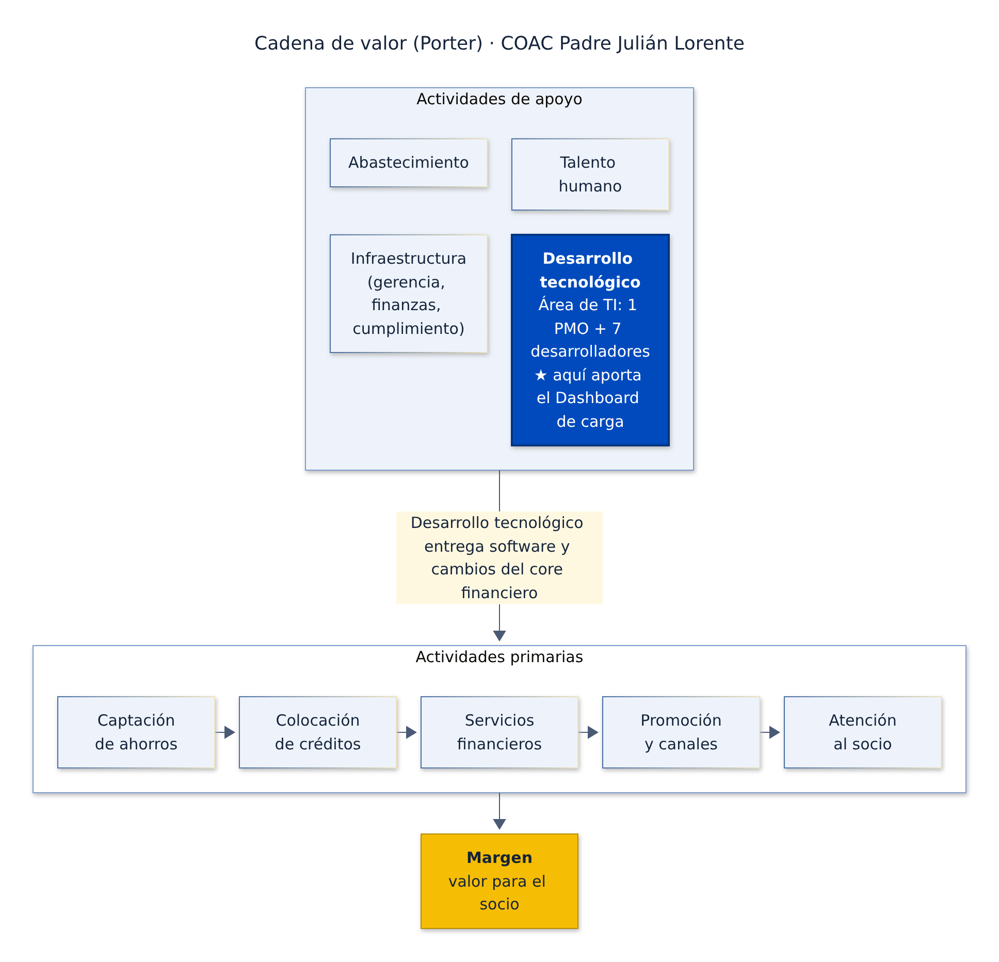

## 2. Flujo de valor

De la petición registrada en RedMine a la redistribución del trabajo. El dato llega con 15 minutos de atraso como máximo y la sobrecarga genera una alerta automática.

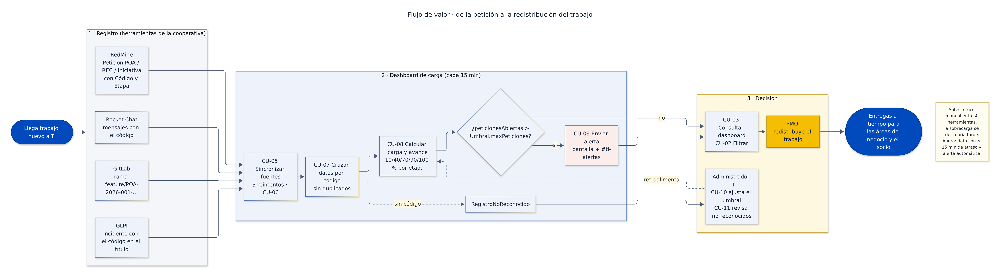

## 3. Mapa de capacidades

Cinco dominios. "Configurar umbral" y "Revisar registros no reconocidos" están solo en Administración. Las capacidades con borde punteado están pendientes.

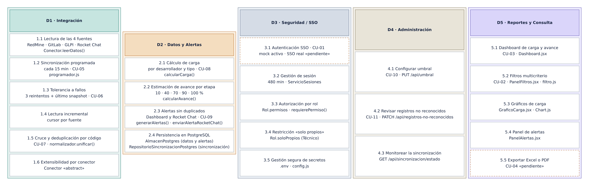

## 4. Casos de uso

4 roles (PMO, Técnico, Administrativo y Administrador TI) que heredan de "Usuario de la cooperativa", el Programador de tareas (cron) y 11 casos de uso. Las fichas están en [04-casos-de-uso.md](../04-casos-de-uso.md).

| Rol | Clave | Permisos |
|---|---|---|
| PMO | `PMO` | `ver:todos`, `exportar` |
| Técnico | `TECNICO` | `ver:propios` |
| Administrativo | `ADMINISTRATIVO` | `ver:todos` |
| Administrador TI | `ADMINISTRADOR_TI` | `ver:todos`, `configurar` |

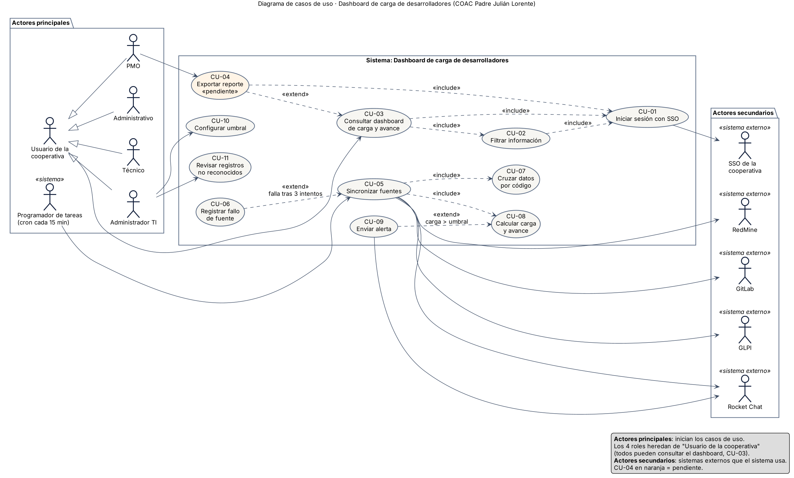

## 5. Clases

Tres paquetes: Usuario web y seguridad, Integración, y Datos y alertas. `AlmacenPostgres` hereda de `AlmacenMemoria` (la memoria funciona como caché de lectura) y comparte el pool de PostgreSQL con `RepositorioSincronizacionPostgres`.

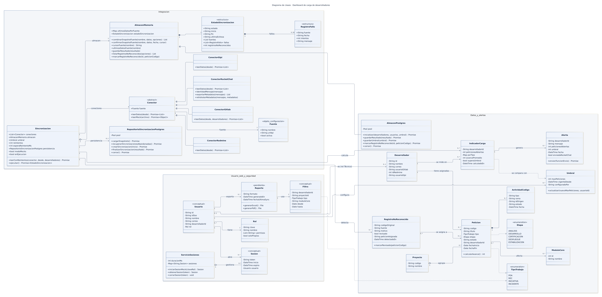

## 6. Diagramas de secuencia

Cada uno sigue el camino actor → componente del frontend → endpoint → servicio del backend → base de datos o conector → respuesta.

| Caso de uso | Fuente | Imagen |
|---|---|---|
| CU-01 Iniciar sesión con SSO | [mmd](06-secuencia/CU-01-iniciar-sesion.mmd) | [png](img/CU-01-iniciar-sesion.png) |
| CU-02 Filtrar información | [mmd](06-secuencia/CU-02-filtrar-informacion.mmd) | [png](img/CU-02-filtrar-informacion.png) |
| CU-03 Consultar dashboard de carga y avance | [mmd](06-secuencia/CU-03-consultar-dashboard.mmd) | [png](img/CU-03-consultar-dashboard.png) |
| CU-04 Exportar reporte «pendiente» | [mmd](06-secuencia/CU-04-exportar-reporte.mmd) | [png](img/CU-04-exportar-reporte.png) |
| CU-05 Sincronizar fuentes | [mmd](06-secuencia/CU-05-sincronizar-fuentes.mmd) | [png](img/CU-05-sincronizar-fuentes.png) |
| CU-06 Registrar fallo de fuente | [mmd](06-secuencia/CU-06-registrar-fallo.mmd) | [png](img/CU-06-registrar-fallo.png) |
| CU-07 Cruzar datos por código | [mmd](06-secuencia/CU-07-cruzar-datos.mmd) | [png](img/CU-07-cruzar-datos.png) |
| CU-08 Calcular carga y avance | [mmd](06-secuencia/CU-08-calcular-carga.mmd) | [png](img/CU-08-calcular-carga.png) |
| CU-09 Enviar alerta | [mmd](06-secuencia/CU-09-enviar-alerta.mmd) | [png](img/CU-09-enviar-alerta.png) |
| CU-10 Configurar umbral | [mmd](06-secuencia/CU-10-configurar-umbral.mmd) | [png](img/CU-10-configurar-umbral.png) |
| CU-11 Revisar registros no reconocidos | [mmd](06-secuencia/CU-11-revisar-no-reconocidos.mmd) | [png](img/CU-11-revisar-no-reconocidos.png) |

### CU-01 Iniciar sesión con SSO
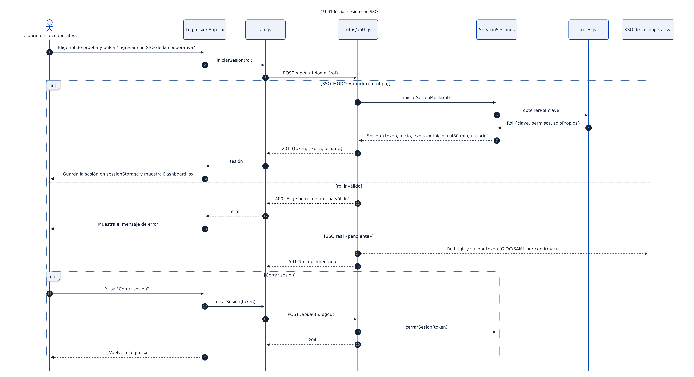
### CU-02 Filtrar información
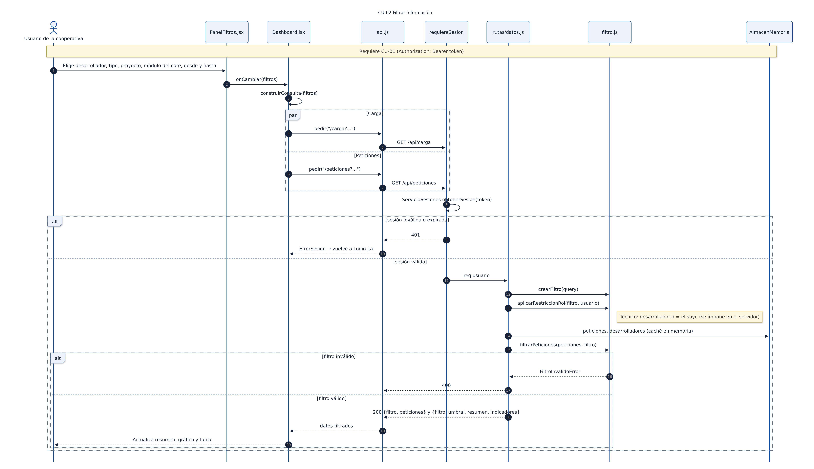
### CU-03 Consultar dashboard de carga y avance
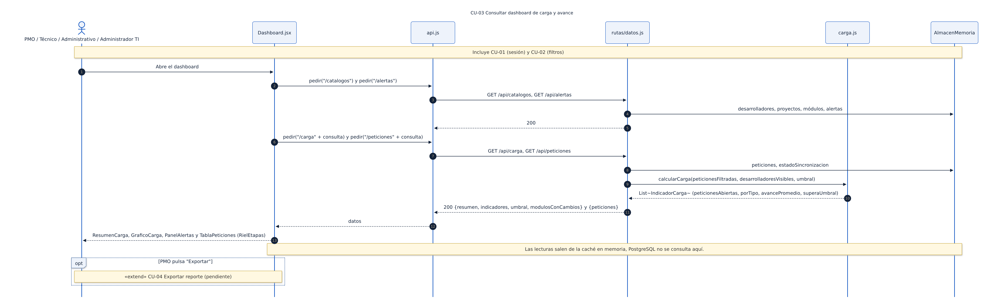
### CU-04 Exportar reporte «pendiente»
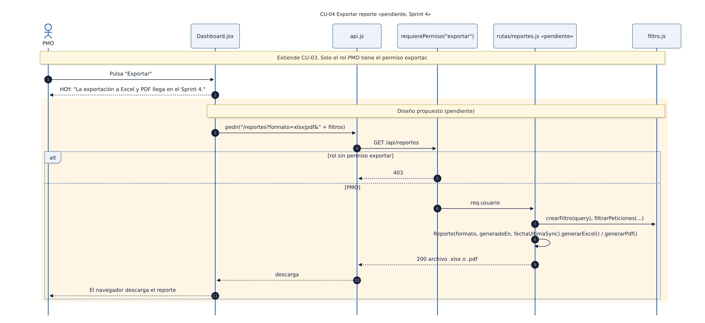
### CU-05 Sincronizar fuentes
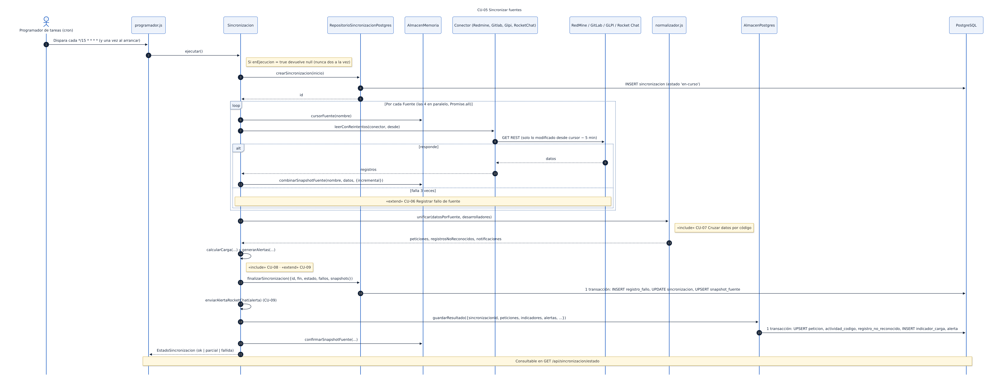
### CU-06 Registrar fallo de fuente
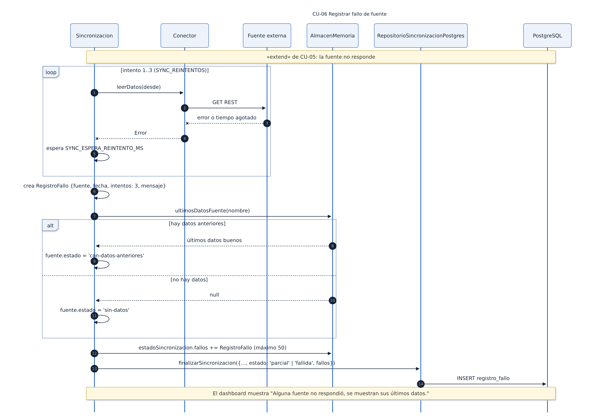
### CU-07 Cruzar datos por código
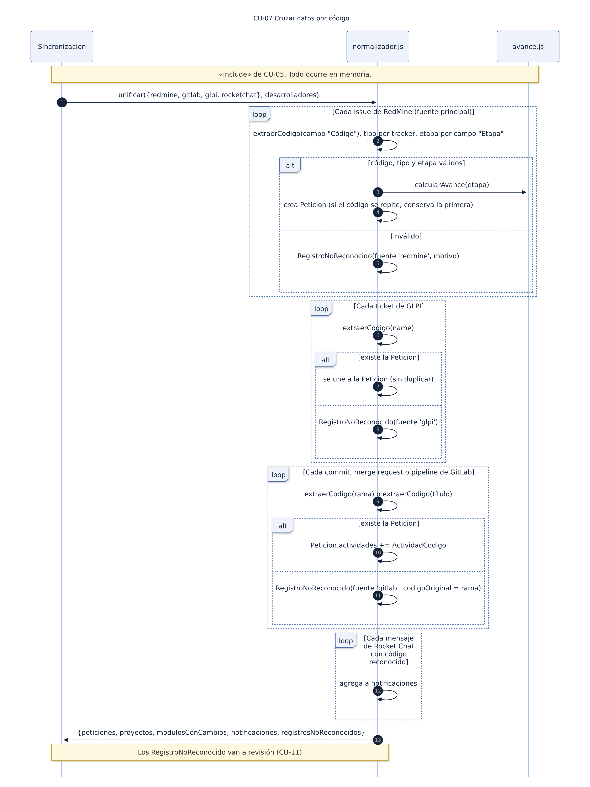
### CU-08 Calcular carga y avance
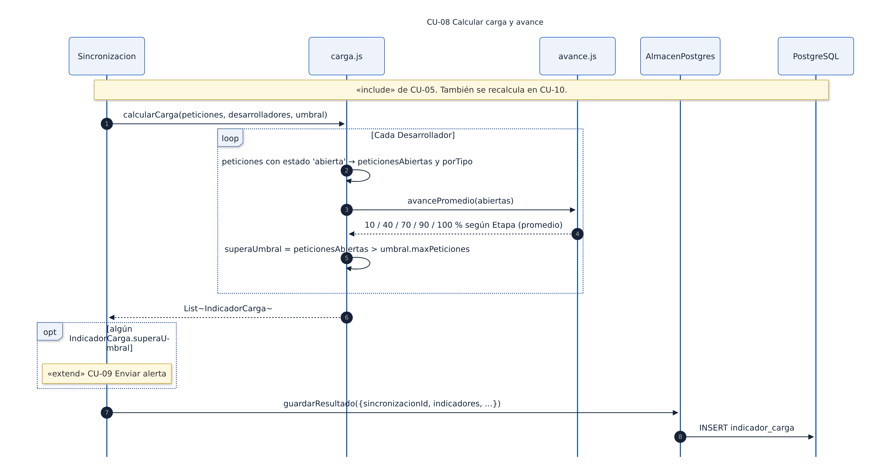
### CU-09 Enviar alerta
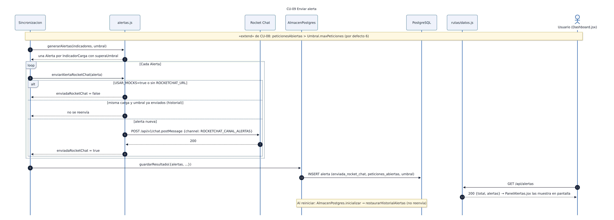
### CU-10 Configurar umbral
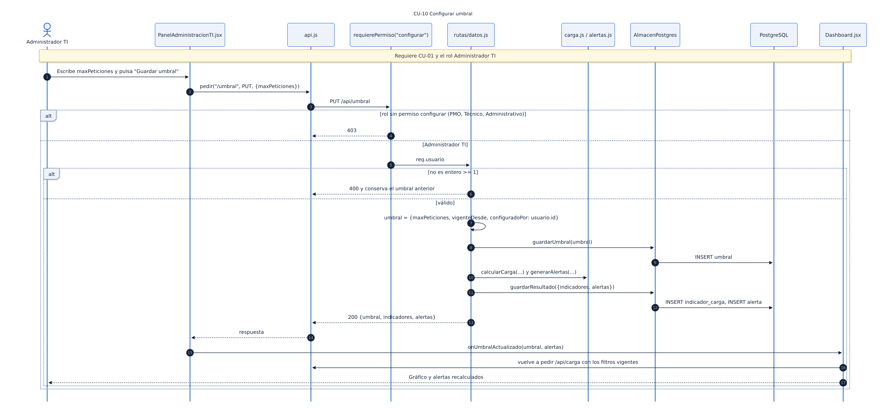
### CU-11 Revisar registros no reconocidos
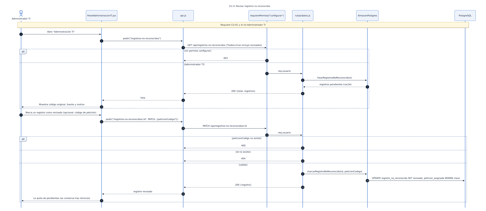

## 7. Componentes

El frontend (React) usa la interfaz REST `/api`. El backend (Express) tiene los subcomponentes auth, rutas, sincronizacion, conectores, datos y config. Los conectores siguen el patrón Adapter: la interfaz `IConector` del diagrama es el contrato `leerDatos(desde)` de la clase abstracta `Conector`.

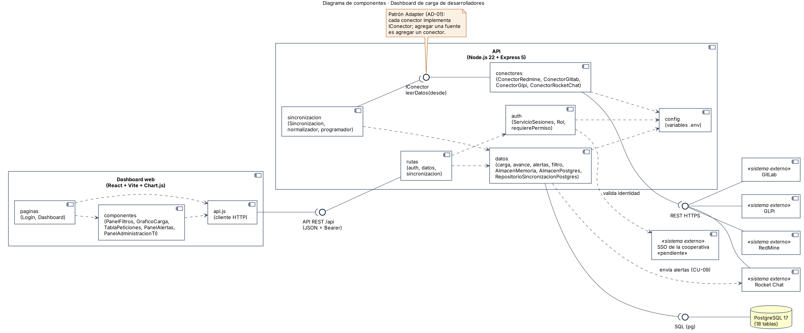

## 8. Paquetes

Las carpetas reales de `frontend/src` y `backend/src` y sus `import`. No hay ciclos: `datos` no importa `sincronizacion` ni `rutas`, y el frontend no importa código del backend (solo usa HTTP).

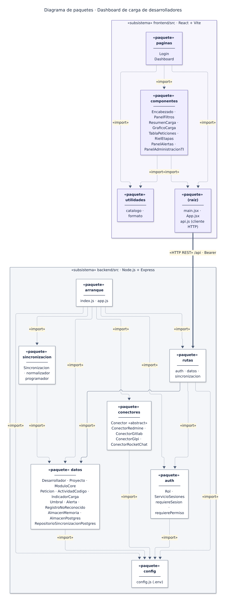

## 9. Despliegue

Tres contenedores con Docker Compose: frontend (nginx, puerto 8080), backend (Node.js, puerto 3000) y postgres (puerto 5432, solo accesible desde el equipo anfitrión), más el volumen `datos-postgres`. Los sistemas de la cooperativa están en su red interna. Hoy se usan datos de prueba (`USAR_MOCKS=true`).

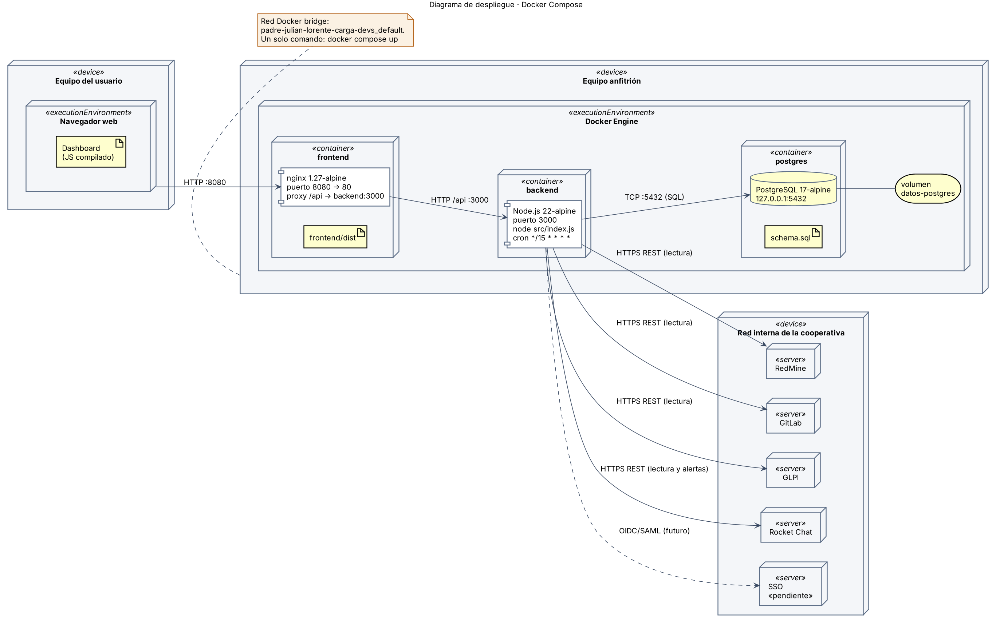

---

## Cómo regenerar las imágenes

- **Mermaid (`.mmd`):** abrir el archivo en [mermaid.live](https://mermaid.live) o usar `npx -p @mermaid-js/mermaid-cli mmdc -i archivo.mmd -o img/archivo.png -s 2`.
- **PlantUML (`.puml`):** `plantuml -tpng archivo.puml` desde esta carpeta (usa `estilo.iuml`), o la extensión PlantUML de VS Code.
